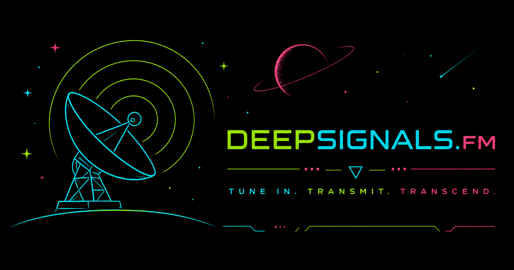

<p align="center">
	
</p>

# DeepSignals.FM

A psychedelic trance radio experience built with React, TypeScript and Three.js.

## Brand

**TUNE IN. TRANSMIT. TRANSCEND.**

| Role                   | Color        | Hex       |
| ---------------------- | ------------ | --------- |
| DEEP / primary signal  | Neon Green   | `#9cff57` |
| SIGNALS / transmission | Neon Cyan    | `#47f7ff` |
| .FM / broadcast accent | Neon Salmon  | `#ff7fa1` |
| Primary background     | Signal Black | `#020202` |

The wordmark colors come from the resolved decoder states in `src/components/publicBrandIdent.css`; Signal Black is the shared `html, body` background in `src/index.css`.

## Current Status

Public service online

The public player carries live music from multiple independent radio partners with immersive, music-reactive visual environments.

## Planned Features

- Multiple visual environments
- Psytrance radio player
- Theme engine
- Community stations
- AI-generated visual experiences
- AI DJ experiments

Built primarily as a learning project and a love letter to psychedelic trance.

## E2E Testing

The 28-test Playwright regression suite tests the production build through Vite preview, not the Vite development server.

Install the browser once with `npx playwright install chromium`, then run `npm run test:e2e`. The HTML report is written to `playwright-report/` and can be opened with `npx playwright show-report`. Run one spec with `npx playwright test tests/smoke/player.spec.ts`.

The behavior spec also runs against the bundled `Illustrator — Psychedelic Experience` demo track, so it does not depend on live radio or metadata services. Run it with `npx playwright test tests/behavior/motion-chroma.spec.ts`.

Phase 2B also covers Race volume-zero and volume-ramp behavior, qualified SURGE during local demo playback, and the shared qualifier's arm/cooldown semantics. Run `npx playwright test tests/behavior/volume-surge.spec.ts tests/behavior/surge-qualification.spec.ts`.

## Asteroid Runner: focused encounter refinement

**Asteroid Runner** remains independent of the original Signal Runner. Its current scene-specific details below supersede the historical Phase 2 inventory in the runtime guide; the shared runtime contract is unchanged.

- The distant ringed planet and background nebula are removed, including their shaders, geometry, materials and crossfade logic. Open space remains dark and star-filled. Signal gates are unchanged.
- [The journey](src/themes/signal-runner-2/runnerJourney.ts) retains three recycled region slots. Asteroid fields now span **1,440 units instead of 480** (18 seconds at the normal 80-unit/sec ceiling; longer with quieter music). Open and gate regions remain 480 units. Each field has three smooth planned bypasses, 420 units apart: 5.25 seconds between closest passes at full cruise, or 1.75 seconds at the temporary 240-unit/sec SURGE ceiling. Overlapping low-amplitude tails allow partial recentering without sharp turns.
- Each field contains 105 ordinary/debris rocks, two 12-18-unit major rocks and one seeded **26-30-unit hero**. The fractured geometry, geological colors, CHROMA rim/seams and tumbling are unchanged. Navigation clears the full 1.35x tumbling bounds, alternates lateral sides with modest vertical variation, and retains the 0.065-radian bank limit and 38-unit lookahead. Rocks stay in one instanced draw with the same **108-instance GPU capacity**; the three CPU region pools now hold 324 reusable rock records.
- [One pooled spacecraft](src/themes/signal-runner-2/runnerTraffic.ts) still appears every eight regions, only in open space. Six seeded variants cycle through left/right, diagonal and approaching/receding crossings, with the nose aligned to travel. A low-poly swept hull, canopy, paired nacelles, dorsal fin and DSFM accent strips improve readability without external models.
- Propulsion effects use **six light instances** (including two engine cores), **two exhaust-cone instances**, and **64 reusable mist/spark points**. Analytic lifetimes need no emitter or history queue. Cyan/lime/salmon interpolation and modest audio/SURGE intensity use the existing frozen animation clock; CHROMA OFF is restrained blue-gray. All four ship draw objects hide between events and dispose on unmount.
- The scene has **12 drawable objects, down from 13**, including four ship batches (up from two), with 900 stars and three SURGE rings unchanged. There are no textures, loaders, extra lights, postprocessing or additional animation loops. Only nearby rock/gate instances draw. Pause, MOTION OFF and reduced motion freeze navigation, tumbling, ship/exhaust and SURGE; normal propulsion, shared qualification, volume response, DPR cap and actual-render FPS sampling are unchanged.

Run `npx playwright test signal-runner-2.spec.ts surge-qualification.spec.ts volume-surge.spec.ts player.spec.ts` for focused geometry/pool tests, shared/player regressions, real-audio travel, freezes, desktop/mobile captures and cleanup after a rendered flyby. For visual inspection, watch an entire three-dodge field, the hero approach and near-pass, gradual recentering, the ship's nose/trail alignment across variants, CHROMA OFF/ON and pause during exhaust. At full cruise the first field starts around six seconds into travel and lasts about eighteen seconds; actual timing follows music energy.

## Deep Space Drift: Phase 3

Select **Deep Space Drift** under **3D EXPERIENCES**. The approved rotating rings, monoliths, slabs, path and open intervals are preserved. CHROMA OFF is dim, stable dark-teal machinery; ON is brighter DSFM cyan/green/salmon architecture with independent band illumination and traveling color. Playback pause, MOTION OFF and reduced motion freeze travel, rotating halos, suspended ribs, packets, SURGE clocks, wavefronts and streaks. Independent audio color response is still permitted with MOTION OFF. No new analyser, camera banking, FOV animation or player default changes.

Audio is read once per frame from the player's shared snapshot. Lighting uses `0.75 * smoothedEnergy + 0.25 * energy` for overall activation; clamped `0.7 * bass + 0.35 * bassPulse + 0.5 * kickPulse` emphasizes major rims and pylon channels; `mids` drives segmented mechanical bands and traveling rails; clamped `0.7 * highs + 0.5 * transient` activates small ribs, markers and sparse bright-star glints. Local attack/release smoothing preserves visible pulses without a global strobe. Ring circumference, pylon collars and bridge ribs activate at different spatial phases. CHROMA OFF suppresses ordinary audio illumination but retains restrained SURGE brightness.

[transitMotion.ts](src/themes/alien-megastructure-transit/transitMotion.ts) maps effective analyzed energy (`0.65 * smoothedEnergy + 0.35 * energy`, normalized from 0.012 to 0.562, clamped and squared) into a normal target range of **0-420 world units/sec**. Speed uses frame-rate-independent damping: attack rate 3/sec, release 1.8/sec. Missing/inactive/invalid analysis targets zero; mute settles speed to zero. Volume is not read or multiplied again. SURGE raises the temporary ceiling to **1,100 units/sec**, still weighted by effective energy.

SURGE uses the shared qualifier at up to 20 Hz: mapped energy <=68 for 400ms arms it, a subsequent rise >=99 triggers it, and shared cooldown is 1,500ms. Accepted-event sequence metadata is passed through; this remains energy hysteresis, not a trigger on every beat. Local events cannot overlap. The **4.2-second** envelope has a smooth 400ms attack, holds through 2.4 seconds, then releases over 1.8 seconds. Gated motion resets arming but freezes an existing event. During SURGE, activation travels from distant machinery toward the viewer, architecture flares with a local DSFM color sweep, three large pooled wavefronts approach along the shared path, and 24 sparse streaks reinforce speed. The near-black background/fog briefly washes deep teal toward violet, then returns to black; CHROMA OFF keeps this dimmer and teal-only.

The unchanged [transitWorld.ts](src/themes/alien-megastructure-transit/transitWorld.ts) still owns six recycled encounter slots. [transitArchitecture.ts](src/themes/alien-megastructure-transit/transitArchitecture.ts) retains seven batches and 758 active architectural instances (21,984 triangles). [transitSpace.ts](src/themes/alien-megastructure-transit/transitSpace.ts) replaces the patterned stars with seeded spherical random positions, randomized luminance and three size classes: 330 tiny/dim, 76 medium, 14 bright/large. Stars are mostly neutral; only the sparse bright class has subtle high-band cyan glints. Total stars stay at 420. Normal rendering uses 10 draw calls; SURGE adds two instanced draws (3 waves + 24 streaks), bringing the maximum to 12 draws / 24,576 triangles. Two simple lights, capped DPR, no textures, shadows, custom shaders, bloom or postprocessing. All resources are bounded and explicitly disposed.

For review, compare CHROMA OFF/ON repeatedly, ring bass response versus halo mid response, pylon vertical pulses, bridge underside sequences, and natural star spacing. Let the demo play from the beginning for a real qualified SURGE; compare full volume, 12%, 3% and mute. Encounter timing now follows musical energy instead of fixed seconds. Inspect the approaching waves, distant-to-near activation, void tint, portrait near-pass framing, and pause/MOTION freezes during an active surge. Open-space intervals and camera clearance are unchanged.

Run `npx playwright test tests/behavior/alien-megastructure-transit.spec.ts` for deterministic propulsion/SURGE/band/star tests, maximum-speed clearance, real demo volume and SURGE, bounded pools, control gates, live canvas checks, GPU/loop cleanup including active effects, FPS clearing and desktop/mobile screenshots. FPS is sampled only after actual draws.

## Player Architecture

### Twilight Tides: reactive twin-sun sky

Select **Twilight Tides** under **3D EXPERIENCES** in `/player/`. The unchanged fixed camera overlooks an open twilight ocean, starting with an orange/pink horizon, magenta/violet cloud veils and an indigo/near-black upper sky. A larger green alien sun sits upper-right of the smaller amber sun, with matching reflection and highlights. Both bodies have stable, saturated colors, soft angular edges, gentle limb shading and a restrained atmospheric halo. The existing cloud veils now composite **in front of the suns**; opacity is capped at 58% to retain readability. Sparse, seeded stars twinkle gently behind the clouds. No camera navigation or shoreline scenery is added.

[The always-present aurora](src/themes/twilight-tides/twilightAurora.ts) adds three overlapping, soft-edged curtains in the upper-mid sky. Folded mint/cyan/blue bases feather into violet and salmon fringes, with translucent emission, fine vertical structure and a small tint from the current cloud palette. Angular masks leave space around both suns and fade the light before the horizon, sky edges and zenith. The aurora composites behind the existing suns/cloud veils, not as a screen overlay. CHROMA OFF retains a dim, restrained authored curtain with no band accents or traveling hue. No separate SURGE event is implemented.

Aurora motion reuses the existing frozen `skyTime`; sustained width reuses `waterEnergy`, and overall brightness uses `colorEnergy`. New bounded, frame-rate-independent envelopes read the same shared snapshot: `clamp(0.55 * bass + 0.35 * bassPulse + 0.85 * kickPulse)` drives width and localized crest-light waves (9/sec attack, 3/sec release); `mids` bends the ribbons (4/2); `clamp(0.8 * highs + 0.5 * transient)` reveals fine shimmer (7/3.5). Each band target is weighted by the existing mapped music energy, so stale bands cannot animate silence. Quiet/muted playback settles smoothly to narrow, dim, slowly drifting ribbons rather than removing them. Pause, MOTION OFF and reduced motion freeze all new band/shape envelopes and spatial progression; independent overall CHROMA illumination remains permitted under MOTION OFF/reduced motion, and pause holds everything. These envelopes do not feed water turbulence, cloud speed, sun colors or meteor scheduling.

[The ocean renderer](src/themes/twilight-tides/twilightOcean.ts) retains the techniques demonstrated by the [Three.js WebGL ocean](https://threejs.org/examples/#webgl_shaders_ocean): layered scrolling normals, Fresnel reflections, sun highlights and three low-amplitude foreground swells. Cloud noise is baked once into the existing small cubemap. A shared directional shader applies slow cloud drift/warping, evolving twilight colors, both suns, stars and shooting stars to **both the visible sky and water reflections**, without per-frame cubemap updates. Sun colors also drive their directional water highlights. Both reflected sun discs and specular highlights now fade out at grazing viewing angles (0.012..0.035 vertical eye-direction component), placing their start slightly below the horizon independently of viewport height. The far water blends completely into the actual zero-elevation sky color, removing the bright finite-grid seam without flattening foreground reflections. No WebGPU, bloom, HDRI, external texture, model, new analyser or debug interface is required.

The same directional aurora is evaluated at the existing rippled reflection direction, at **45% contribution** before the unchanged Fresnel and haze treatment. This supplies coherent colored traces rather than a second bright sky on the water. It adds no reflection pass or texture, and does not change the horizon fade or solar-highlight suppression.

Shared `smoothedEnergy` maps 0.015..0.5 into 0..1 with a 0.75-power curve, making ordinary playback visibly reactive without amplifying effective silence. Water energy damps at 2.4/sec attack and 1.6/sec release; atmospheric color at 2.5/1.5. Water time still runs at **0.045..1.145 units/sec**, turbulence at **0.65..1.5**, and sky drift at **0.025..0.425 units/sec**. The previous `kickPulse` sun-hue response remains removed: kicks now accent only the aurora, alongside the existing smooth water/cloud motion, atmospheric illumination and restrained bass/high reflection shimmer. The suns evolve only with the slow palette clock, bypass the atmosphere's energy brightness multiplier, and never flash on beats. Reflected discs, halos and highlights use the same current sun colors and cloud attenuation. No extra analyser, DOM-meter reads or second volume multiplier. Mute, inactive/missing/invalid analysis and very quiet sound settle to extremely slow ambient movement while playback/MOTION remain enabled.

Pause, MOTION OFF and reduced motion freeze water turbulence, cloud drift, sun colors, palette evolution, star twinkle and active meteor progression. Independent audio-driven CHROMA atmospheric illumination may still respond with MOTION OFF or reduced motion; pause holds current lighting. CHROMA OFF uses the restrained authored palette, steady stars and no meteors, while permitted ocean/cloud movement continues. ON follows a **300-second eligible-playback cycle** through four authored moods: **warm pink/orange/purple → rose/indigo/blue → violet/green → coral/cyan → warm**. Each 75-second transition uses smoothstep interpolation with zero slope at its endpoints, including the loop seam. Ten reusable linear-light palette colors are interpolated once per frame on the CPU and shared by the sky, cloud layers, suns and water reflections. Sun colors are authored for contrast with each mood; the upper star region stays dark. The cycle is independent of music energy; CHROMA OFF freezes its clock and ON resumes it.

The single analytic meteor slot first becomes eligible after **8 seconds** of audible, motion-enabled CHROMA playback. Normal waits are now **8..16 seconds** after each unchanged 1.8-second soft trail; every fourth event is followed by a **2.8-second wait**, creating occasional close pairs without simultaneous streaks. Six short paths alternate across the upper sky. A sustained-audible four-minute simulation produces 19..23 meteors (previously 7..9), with trails present less than 18% of the time. Events cannot overlap and no new events start at effective silence. This is ambient scenery, not SURGE.

Quality limits are unchanged: a 256px-per-face cloud cubemap and 112x144 water grid on desktop, 128px and 72x96 for compact/coarse-pointer or <=4-core devices. Resize caps DPR at 1.6/1.25 and drawing-buffer budgets at 2.6M/1.1M pixels. The generated 128x128 RGBA ripple-normal texture remains 64 KiB before mipmaps; **no assets or dependencies are added**. There are still six one-time bake draws and two draws per frame, with no extra meshes, reflection pass, lights or postprocessing. Palette interpolation moves out of the fragment shader; soft solar halos add modest analytic fragment work. Cloud occlusion reuses the same cubemap sample, including for reflected highlights, rather than adding texture lookups. Stars and meteors remain analytic features, not particle systems. Both sun discs are analytic to avoid cubemap pixelation. Resource disposal, context release, resize handling and actual-render FPS telemetry are unchanged.

Aurora cost is three scalar uniforms/envelopes plus a fixed three-layer analytic fragment loop, evaluated only within its directional sky region in both materials. It adds trigonometric/exponential work but no GPU resources, texture lookups or per-frame allocations. Derivative filtering suppresses subpixel filaments, particularly in rippled reflections. This is a lightweight stylized curtain, not volumetric ray marching; real mobile-GPU performance still needs device testing.

The baked cloud map is regenerated after WebGL context restoration; lost-context callbacks neither advance the ocean nor count as rendered FPS. Run `npx playwright test twilight-tides.spec.ts player.spec.ts` for runtime, aurora band isolation/smoothing, always-present quiet/CHROMA-OFF curtains, measured sky/water contribution, real-audio aurora and mute decay, bounded meteor/control gates, measured music-versus-mute water changes, sun-color stability, cloud occlusion/soft-edge checks, horizon pixels at four desktop/mobile heights, sun contrast across palette/cloud positions, five-minute clock continuity, context-restoration and cleanup coverage. Tests also record uninstrumented desktop/compact FPS observations and aurora screenshots with controls hidden only during capture. Let Playwright start its configured preview, or rebuild a reused preview with `VITE_HIRSCHMILCH_METADATA_URL=http://127.0.0.1:4173` for the player metadata mocks.

For local visual review, run `npm run dev`, open `/player/`, select Twilight Tides and play either existing demo or radio. Compare quiet/loud passages and kick-driven ribbon crests, mid-band bending and fine high-band shimmer; the suns must not flicker. Compare CHROMA OFF/ON, volume/mute, pause/resume, MOTION OFF and reduced motion (set the preference before reload). Collapse the player and close INFO to see more upper sky; the existing compact player still overlaps much of the aurora on narrow portrait screens. Resize vertically to inspect the clean horizon and subdued aurora reflections. Watch 10..60 seconds for shooting stars and close pairs, and five minutes for all four palette moods. Use the existing FPS readout and diagnostics.

For new visualization work, start with the [visualization theme authoring and runtime guide](docs/environment-runtime-contract.md). It covers canonical scenes, registration, lifecycle, controls, shared audio/SURGE, FPS, performance, and testing.

Hirschmilch track metadata uses a small server-side [Cloudflare Worker](docs/hirschmilch-metadata-worker.md) because its metadata service does not support browser clients. Hirschmilch audio still streams directly to the browser.

Psybient Sunset is available as an External Signals test station, using its station logo with no metadata or telemetry integrations. The shared audio element sets `crossOrigin = 'anonymous'` before assigning any source and reuses the existing analyser across station switches. External Signals is alphabetized in the player selector. Run `npx playwright test tests/smoke/psybient-sunset.spec.ts` for deterministic coverage; set `DSFM_LIVE_STREAM_TEST=1` to also test the real Psybient Sunset stream and existing stations (requires reachable live services).

The architecture notes below are historical: their environment inventory and some control/volume descriptions predate the current implementation. Use the guide's source references for current behavior.

DeepSignals.FM currently features **19 registered environments** across several distinct families, each with different audio-reactivity contracts and visual semantics.

The player is designed to be extended through well-defined audio signal contracts rather than duplicating analysis pipelines in every new environment.

### Environment Inventory

**Three.js Environments (3):**

- **Signal Runner**: Audio-reactive signal flight with sustained-energy travel
- **Race to the Signal Nexus**: High-performance travel track with smooth energy-based speed
- **The Signal Nexus**: Standalone complex reactive scene with orbital/particle systems

**Minimal Environment (1):**

- CSS-based fallback, no audio reactivity

**2.5D Image-Depth Environments (15):**

- Production-preset environments (7): UV Reactive Jungle, Analog Signal Laboratory, Bioluminescent Psy Forest, Bioluminescent Psy Reef, Crystal Cavern, Slime Cavern, Female DJ 1
- Additional registered environments (8): Psychedelic Temple, Alien DJ 1, Dark Psy Temple, Dark Ritual Swamp, Energy Rift Swamp, Female Meditation 1, Lost Relay Tower, Psy Swamp Citadel

The public player currently exposes 10 of these via the environment dropdown.

## Player Control Semantics

The player provides four control dimensions: **PLAY/STOP**, **MOTION**, **CHROMA**, and **VOLUME**. These controls implement shared semantics across all environment families, though family-specific behavior notes are documented separately.

### PLAY / STOP

**PLAYING** state enables audio analysis and audio-driven reactivity.

**STOPPED** state:

- Audio-derived values return toward neutral (zero energy, zero frequency data, etc.)
- Audio-driven scene behavior stops
- Some environments may retain **authored** or **procedural** non-audio visuals while stopped

Do NOT assume every visual effect freezes on STOP. For example, some Three.js environments may continue procedural animation or color effects that are not audio-dependent.

### MOTION

**MOTION ON** (default) permits:

- Spatial animation: travel, parallax, camera/world movement
- Geometric animation: rotations, scale changes, object motion
- Time-based scene evolution where applicable
- SURGE geometry movement

**MOTION OFF** freezes all spatial/time-based animation specific to motion, but:

- CHROMA/color response may continue
- Procedural time-independent effects may continue
- Lighting may respond to audio if environment design allows

MOTION is **independent** from CHROMA. Disabling motion should not disable color/hue response.

### CHROMA

**CHROMA ON** (default) enables:

- Dynamic hue/palette behavior
- Shared mapped chroma hue (if environment uses it)
- Audio-driven color reactivity

**CHROMA OFF** returns colors to stable authored palette. The visual result depends on environment design but generally eliminates audio-driven color changes.

### VOLUME

The audio analysis pipeline operates as:

```
audio source → analyser → destination
```

The analyser examines audio **before** the speaker output volume control.

**Important**: Audio-analysis snapshots use the analyzer connected directly to the media source (`source → analyser → destination`), so they are **NOT automatically volume-attenuated** by the player output level. Scenes that want direct player volume control must apply it explicitly.

**Current volume behavior by environment:**

- **Signal Runner**: Volume is not part of the environment's explicit travel mapping. It uses its own audio-driven travel behavior and may retain slow forward/coasting movement as musical energy approaches zero.
- **Image-Depth scenes**: Do NOT apply volume to snapshot signals
- **Race to the Signal Nexus**: Volume participates in the environment's travel mapping, so volume zero settles primary travel to a stop.

**Current presentation difference**:

- **Race to the Signal Nexus** can reach a complete stop at volume zero because volume participates in its primary travel mapping.
- **Signal Runner** may retain slow idle/coasting movement even when energy approaches zero. These family-specific behaviors are intentional and do not need normalization unless future design/testing gives a reason to change them.

**Future implementations**: Avoid accidentally applying volume twice (once in analysis gain, once in the scene). Use current code patterns as reference.

## Environment Families

### 2.5D Image-Depth Environments

These scenes use a parallax depth-map approach with strong beat/depth relationships.

**Audio signal consumption:**

- `bass` → primary parallax depth influence (sustained low-frequency motion)
- Accepted kick / kick envelope → discrete depth-envelope responses (thumps/pulses)
- `smoothedEnergy` → sustained lighting/glow intensity
- `transient` → short accent glow/sparkle effects
- Shared CHROMA hue → palette rotation/color mapping

**Important semantic distinction**: Beat-driven depth thumping is **intentional** for this family and should NOT be treated as a mistake. Depth-map scenes benefit from perceptible kick response for visual rhythm. This is different from the anti-pumping rule for Three.js travel scenes (see below).

**Motion gating behavior:**

- MOTION OFF: Depth parallax and autonomous breathing freeze; lighting/CHROMA reactivity continues
- Reactive depth envelopes: Controlled by geometry-motion gating, not independently available while motion is off

**Authoring approach:** These scenes excel at artistic visual interpretation of depth. Strong parallax + beat thumping is a valid design pattern for this family.

### Modern Three.js Travel / Reactive Environments

**Signal Runner** and **Race to the Signal Nexus** represent the contemporary pattern for Three.js environments.

#### Core principle: Separate sustained motion from beat detail

**Sustained travel** uses `smoothedEnergy`:

```
smoothedEnergy (sustained audio envelope)
  → normalized to [0, 1]
  → mapped to target speed
  → eased to current speed
  → accumulated for world position
```

This produces smooth acceleration/deceleration, not tick-by-tick pumping.

**Beat detail** uses `kick` and `transient` for:

- Localized reactor pulses
- Short accent geometry
- Discrete visual detail, not large-scale motion

**Why not use raw kick for travel?**

Direct kick/transient usage causes undesirable:

```
fast → slow → fast → slow → fast
```

pumping, especially noticeable during kick-heavy music. Smooth energy preserves musical alignment without distraction.

**Volume in Race to the Signal Nexus:** Volume participates explicitly in the travel mapping and gives the player direct control over that environment's primary travel energy. Do NOT assume the same volume semantics for Signal Runner without an explicit design decision.

**Motion/CHROMA behavior:**

- MOTION OFF: All spatial travel and world animation freezes; procedural twinkle and CHROMA may continue
- CHROMA ON: Shared mapped hue affects environment colors while playback is active; hue resets when stopped
- SURGE: Rare qualified burst event (see below) may temporarily override normal behavior

#### Implementation pattern

New Three.js travel environments should:

1. Consume `smoothedEnergy` for travel/locomotion semantics
2. Use `kick`/`transient` for localized short-lived detail only
3. Implement shared CHROMA hue mapping rather than custom color analysis
4. Respect MOTION and CHROMA gates
5. Create artistic interpretation of signals, not duplicate analysis

### The Signal Nexus

Standalone older implementation with richer local reactive mappings:

- Mapped from `smoothedEnergy`, `bass`, `mids`, `highs`, `kick` into multiple reactive dimensions
- Orbital/particle/lane reactivity with independent intensity states
- Local smoothing envelopes per dimension

This environment does not yet represent the finalized modern Three.js pattern. It can later be deliberately migrated to use shared signals.

**Current status**: Functional; do not use as template for new environments. Reference Signal Runner / Race to the Signal Nexus instead.

### Minimal Environment

- CSS-based fallback with no Three.js
- No audio reactivity
- MOTION and CHROMA controls not exposed in UI
- Intended as lightweight static backdrop

---

## Audio Reactivity Signal Reference

The audio-analysis pipeline produces these signals available to environments via `AudioReactiveSnapshot`:

### `smoothedEnergy`

**Represents:** Sustained musical energy across the audio spectrum.

**Temporal behavior:** Attack ≈0.2/sec, Release ≈0.04/sec (exponential envelope).

**Good for:**

- Travel speed / locomotion semantics
- Large-scale scene intensity
- Sustained visual state
- CHROMA hue mapping target
- Overall energy/presence

**Avoid for:**

- Short-lived visual detail
- Beat-by-beat thumping (use `kickPulse` instead)

### `kickPulse`

**Represents:** Low-frequency beat response (kick drum, bass transients).

**Temporal behavior:** Attack ≈0.78/sec, Release ≈0.16/sec; cooldown 205ms between detected events.

**Good for:**

- Depth thumps (image-depth scenes)
- Localized reactor/core pulses
- Discrete beat details
- Short accent lighting

**Avoid for:**

- Primary vehicle speed (causes pumping)
- Sustained motion

### `transient`

**Represents:** Broadband onset energy (sudden spectral change of any frequency).

**Temporal behavior:** Fast attack ≈0.48/sec, moderate release ≈0.16/sec, cooldown 95ms.

**Good for:**

- Sparkle/accent effects
- Short hi-hat response
- Localized flashes
- Transient detail

### `bass`, `mids`, `highs`

Frequency-band-separated energy:

- `bass`: 30–220 Hz (kick, sub-bass)
- `mids`: 180–2000 Hz (vocals, snare, mid-range synths)
- `highs`: 2–10 kHz (cymbals, presence, sparkle)

**Use case:** Component-specific reactivity where appropriate (e.g., bass for depth, highs for particles). Do not over-prescribe globally.

### `kickPulseAcceptedEvent` / `kickPulseAcceptedEventCount` / `kickPulseAcceptedEventSequence`

Discrete accepted beat event detection.

**Important clarification:**

```
acceptedKickEvent ≠ SURGE
```

Multiple accepted kicks occur continuously without triggering a SURGE. The kick event provides the raw beat information; SURGE is a separate qualified state machine.

---

## CHROMA / Hue Mapping Semantics

Environments that support CHROMA (all except Minimal) use a shared hue mapping:

```typescript
targetHue = mapSignalToHueDegrees(smoothedEnergy);

currentHue += (targetHue - currentHue) * temporalSmoothingResponse;
```

**Key pattern:**

Do NOT use:

```typescript
lerp(0, targetHue, response);
```

That scales/compresses the target. Instead, temporally smooth **toward** the target, preserving its magnitude.

**Visual implementation:**

Authored material colors should be **rotated** by the shared hue offset rather than replacing every object with one absolute color. This preserves authored palette relationships while enabling dynamic hue response.

---

## Shared SURGE Semantics

A shared qualification algorithm in `sharedSurgeQualification.ts` provides a qualified high-energy event.

### Current Architecture

**Race to the Signal Nexus** currently consumes this shared qualifier. Signal Runner does not currently consume qualified SURGE state.

### Qualification Semantics

**State machine behavior:**

1. **Arm** when `smoothedEnergy` ≤ 68% for ≥400ms
2. **Trigger** when energy rises above 99% while armed
3. **Cooldown** for 1500ms before next possible trigger
4. **Reset** when playback stops or MOTION is disabled

**Sequence participation:** `kickPulseAcceptedEventSequence` participates in event semantics for tighter rhythm coupling.

### Important distinction

```
accepted kick event (continuous)
≠
SURGE (rare qualified burst)
```

Multiple kicks occur without triggering SURGE. SURGE is the qualified state transition, not every beat.

### Visual interpretation

Each environment decides how to visualize the same semantic event:

- **Race to the Signal Nexus** → Nexus/starfield overload with surge waves and bolts

This separation of **shared semantics** (when the event occurs) from **family-specific visualization** (how it looks) is the key pattern.

---

## Building Environments

### Building a New Three.js Reactive Environment

New travel-style or complex Three.js environments should consume shared semantic signals rather than reimplementing audio analysis.

**Input signals available:**

```
playback state (isPlaying)
motion enabled (motionEnabled)
chroma enabled (chromaEnabled)
smoothedEnergy
shared mapped chroma hue (calculated externally)
shared SURGE qualification (via helper)
optional localized detail:
  kickPulse
  transient
  bass / mids / highs
```

**Design pattern:**

1. **Sustained motion/state:** Use `smoothedEnergy` for travel speed, world intensity, large-scale evolution
2. **Beat detail:** Use `kick`/`transient` for localized fast effects, not primary motion
3. **Color:** Consume shared chroma hue for palette rotation; apply it to materials via offset rather than absolute replacement
4. **Motion gating:** Respect `motionEnabled`; freeze spatial animation but allow CHROMA/procedural effects
5. **SURGE:** Call `updateSharedSurgeQualification()` to detect rare burst events; decide how to visualize them
6. **Authorship:** Create artistic interpretation, not a duplicate audio-analysis pipeline

**Why reuse signals?**

- Consistency across environments
- Reduced complexity
- Easier to tune global audio response
- Future agents understand established patterns

**Code reference:** Signal Runner (`src/experiments/signal-runner/SignalRunnerScene.tsx`) and Race to the Signal Nexus (`src/themes/neon-hyper-racer/NeonHyperRacerTheme.tsx`) are the primary examples.

### Building a New 2.5D Image-Depth Environment

The existing workflow below is proven and should be used for all new image-depth scenes.

**Key reactivity notes specific to this family:**

- **Bass → Depth**: Bass-band energy directly influences parallax depth displacement (sustained low-frequency motion)
- **Kick → Depth envelope**: Accepted kick events trigger discrete depth-thumping envelopes (fast attack, slower release)
- **Energy → Lighting**: Sustained `smoothedEnergy` drives glow, saturation, and brightness pulses
- **Transient → Accent**: Short broadband transients add accent glow (hi-hat sparkle effect)
- **CHROMA**: Shared hue mapping applies to palette rotation; enable/disable via CHROMA toggle

**Design philosophy:**

Beat-driven depth thumping is intentional and appropriate for this family. Do NOT try to replace all depth motion with smooth travel energy; that rule applies to Three.js travel scenes, not depth-map artistic displacement.

Strong visual rhythm from kick response is a valid design goal for image-depth themes.

## Image Environment Workflow

DeepSignals.FM uses a source-controlled workflow for image/depth environments.

Proven workflow:

1. Generate or create source artwork.
2. Upscale to the desired master resolution.
3. Generate a matching depth map.
4. Optimize the production color asset.
5. Create `public/environments/<id>/`.
6. Add `<id>-color.webp`.
7. Add `<id>-depth.png`.
8. Register the environment in `src/themes/image-depth/environmentCatalog.ts`.
9. Run `npm run validate:environments`.
10. Define or tune behavior in `src/themes/image-depth/productionScenePresets.ts` (or use overrides in the catalog registration seed).
11. Visually verify in `/player`.
12. Optionally verify runtime behavior in `/player` while running locally in DEV.
13. Validate and commit.

Detailed guide: `docs/creating-image-environments.md`

### Removing an image environment

Use this manual cleanup workflow:

1. Remove the environment seed from `src/themes/image-depth/environmentCatalog.ts`.
2. Remove its production preset from `src/themes/image-depth/productionScenePresets.ts`.
3. Remove any now-unused preset imports.
4. Delete its color and depth assets under `public/environments/<environment-id>/`.
5. Delete environment-specific wrapper files under `src/themes/<environment-id>/` only if such files actually exist.
6. Search the repository for the environment id, display name, and preset symbol to confirm no stale references remain.
7. Run `npm run build`, `npm run lint`, and `npm run validate:environments`.

The environment validator derives its total count from the catalog automatically, so a hard-coded environment count usually does not need updating.

## Player State & Behavior Matrix

### Shared Semantics

The player controls define a shared semantic contract across all environments:

| State          | Intended Meaning                                                         |
| -------------- | ------------------------------------------------------------------------ |
| **PLAYING**    | Audio analysis and audio-driven reactivity available                     |
| **STOPPED**    | Audio-derived values return toward neutral; audio-driven behavior pauses |
| **MOTION ON**  | Spatial/time-based scene animation permitted                             |
| **MOTION OFF** | Spatial scene animation frozen; other effects may continue               |
| **CHROMA ON**  | Dynamic color/hue/palette behavior permitted                             |
| **CHROMA OFF** | Stable authored palette; audio-driven color changes suppressed           |
| **SURGE**      | Rare qualified high-energy event used by the Race environment            |

### Family-Specific State Behavior Notes

#### 2.5D Image-Depth Scenes

**MOTION OFF:**

- Depth parallax geometry freezes
- Autonomous depth breathing stops
- Lighting/CHROMA reactivity continues unaffected
- Result: Static depth with active color response

**STOPPED:**

- Grayscale filter animates in
- Audio-driven lighting stops
- Non-audio color effects may persist depending on implementation

#### Signal Runner

**MOTION OFF:**

- Travel and spatial movement freeze
- Star spatial movement stops completely
- The environment uses a Three.js viewscreen; no large CSS/DOM control panel is part of the current player

**STOPPED:**

- Travel speed becomes zero
- Audio signals drop to zero baseline
- Visual elements render at reduced opacity

#### Race to the Signal Nexus

**MOTION OFF:**

- Track travel freezes
- Nexus spatial rotation/scale animation stops
- SURGE-driven geometry movement suppressed
- Star procedural twinkle continues (gated by CHROMA, not MOTION)
- Shared hue mapping continues if CHROMA ON

**STOPPED + CHROMA ON:**

- Star procedural twinkle **may continue** (intentional for testability)
- Shared audio-driven hue resets because analysis is not available while stopped
- Result: Procedural animation without audio color response

**Note:** This star-twinkle behavior is intentional and provides a way to observe procedural animation independent of playback state.

#### The Signal Nexus

**MOTION OFF:**

- Scene elapsed-time completely freezes (unlike modern travel scenes which may continue procedural detail)
- Orbital motion, rotations, traveler movement all stop
- Lighting/color response continues
- Particle opacity may respond to audio if CHROMA is enabled

**Design note:** This older environment does not yet follow the modern pattern of separating motion-gated geometry from color-responsive effects. It is architecturally sound but represents an earlier design phase.

#### Minimal

No state changes; static CSS grid regardless of control state.

---

## Tech Stack

- TypeScript
- React
- Vite
- Three.js
- GitHub Pages
- GitHub Actions

## Local Development

### Prerequisites

Install a current Node.js LTS release, which includes npm.

### Setup

Clone the repository, then install dependencies:

```bash
git clone https://github.com/griffinlochner/DeepSignals.FM.git
cd DeepSignals.FM
npm install
```

Start the local Vite development server:

```bash
npm run dev
```

Vite will print a local URL, typically:

```text
http://localhost:5173/
```

The public landing page is available at `/`.

The public player is available locally at:

```text
http://localhost:5173/player/
```

## Production Build

Create a production build locally with:

```bash
npm run build
```

Vite writes the production-ready files to the `dist/` directory.

To preview the production build locally:

```bash
npm run preview
```

## Commit and Deployment Workflow

GitHub Actions is configured to build and deploy the site to GitHub Pages.

The deployment workflow runs automatically whenever changes are pushed to the `main` branch.

A typical workflow is:

```bash
npm run build
git status
git diff --stat
git add .
git commit -m "Describe the change"
git push origin main
```

What each step does:

- `npm run build` verifies that the production build succeeds.
- `git status` shows the current working-tree state.
- `git diff --stat` provides a compact summary of uncommitted changes.
- `git add .` stages the changes.
- `git commit` saves a local Git checkpoint.
- `git push origin main` uploads the commits to GitHub and triggers deployment.

Deployment progress can be viewed in the repository under:

```text
GitHub → Actions
```

Once the workflow succeeds, GitHub Pages publishes the latest production build to:

```text
https://deepsignals.fm
```

## Notes

- Pushing to `main` deploys the current project build.
- The public landing page is live.
- The public player is live at `/player/`.
- Vite builds `/player/` as a direct multi-page entry for GitHub Pages.
